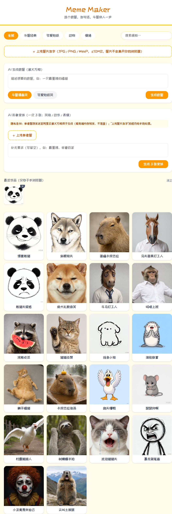
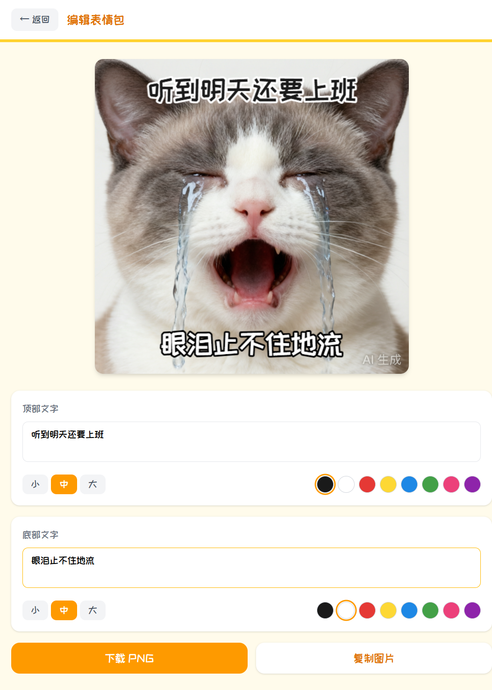

# Meme Maker 表情包生成器

> 选个底图，加句话，斗图快人一步。

免登录、无广告、无水印的网页表情包生成器：模板加字 / 上传加字 / AI 文生图底图 / AI 形象变体，30 秒做一张图，导出无水印 PNG，一键复制进聊天框。

## 功能特性

- **22 张热门梗风原创模板**：面瘫卡皮巴拉、线条小狗、流泪猫猫头、马头面具打工人……全部 AI 原创，版权干净，支持分类与关键词搜索
- **上传图片加字**：JPG / PNG / WebP（≤10MB），纯本地处理，图片不出浏览器
- **AI 文生图底图**：输入描述词，通义万相生成斗图漫画风 / 可爱贴纸风底图
- **AI 形象变体**：上传参考图，一次生成 3 张变体（风格 / 动作 / 表情各一），隐私告知 + 服务端内存转发不落盘
- **简洁编辑器**：顶/底双文字、三档字号、8 色可选；自动换行、超界自动缩字号、按字色反色描边，任何底图上都可读
- **导出**：无水印 PNG 下载；一键复制到剪贴板（浏览器拒绝时自动降级下载）
- **最近作品**：localStorage 历史，点缩略图带原文字配置重新编辑

## 功能展示

### 界面一览

首页：模板库 / 上传入口 / AI 生成 / 最近作品



编辑器：加字自动换行、反色描边，下载 PNG / 复制图片



### 原创模板（22 张，节选 8 张）

| | | | |
| --- | --- | --- | --- |
|  |  |  |  |
| 面瘫卡皮巴拉 | 线条小狗 | 流泪猫猫头 | 马头面具打工人 |
|  |  |  |  |
| 尖叫土拨鼠 | 小丑竟是我自己 | 村霸鹅追人 | 躺平橘猫 |

### AI 文生图底图

输入描述词即可生成不存在的底图（通义万相 `wanx2.1-t2i-turbo`）：


### AI 形象变体

上传参考图，一次生成风格 / 动作 / 表情 3 张变体（`wanx2.1-imageedit`）。示例：给卡皮巴拉戴上墨镜——


## 技术栈

| 层 | 技术 |
| --- | --- |
| 前端 | React 18 + TypeScript + Vite + Tailwind CSS v4 + react-router-dom |
| 渲染 | 原生 Canvas 2D（无重型图片编辑库） |
| 后端 | Express + TypeScript（仅做通义万相 API 代理） |
| AI | 阿里云百炼 DashScope：`wanx2.1-t2i-turbo`（文生图）、`wanx2.1-imageedit`（形象变体） |
| 测试 | Vitest（27 项单测） |
| 部署适配 | Qoder Sites Functions（Deno.serve，代码就绪） |

## 快速开始

```bash
# 1. 安装依赖（npm workspaces）
npm install

# 2.（可选）启用 AI 功能：配置百炼 API Key
cp server/.env.example server/.env
# 编辑 server/.env，填入 DASHSCOPE_API_KEY

# 3. 启动开发服务器
npm run dev
# 前端 http://localhost:5173，后端 http://localhost:3001
```

不配 Key 也能用：模板 / 上传 / 加字 / 导出全部正常，AI 入口显示"未启用"。

## 常用命令

```bash
npm run dev            # 前端 + 后端
npm run dev:web        # 仅前端（模板/上传功能足够）
npm test               # 全部单测（web + server）
npm run build          # tsc 类型检查 + vite 构建
npm run dev:sites      # Sites 模式联调：本地 Functions(8000) + 前端 sites mode
npm run check:functions  # Functions handler 验证（含真实生成主流程）
```

## 项目结构

```
web/                  # React 前端
  src/lib/            # 核心纯逻辑：textLayout / render / export / api / upload / history
  src/pages/          # HomePage / EditorPage
  src/components/     # TemplateGrid / TextControls / AiPanel / VariationsPanel 等
  public/templates/   # 22 张模板 + manifest.json（每张含 credit 版权字段）
  public/fonts/       # 开源站酷快乐体（OFL 协议）
server/               # Express API 代理（Key 只存这里）
functions/            # Qoder Sites Functions 适配层（与 server 行为一致）
docs/                 # 需求研究 / PRD / 技术设计 / 展示文 / Sites 部署方案
dev/                  # 本地 Functions 运行与验证脚本
```

## 隐私与安全

- API Key 只存 `server/.env`（已 gitignore），前端不直连 DashScope，一切 AI 调用走 `/api/*` 代理
- 上传加字纯本地：图片不发送到任何服务器
- AI 变体经用户明确同意与 UI 告知后，参考图由服务端内存转发通义万相，不落盘、不挪用
- 后端只接受白名单参数（prompt ≤200 字、style 枚举）；图片代理仅放行 `https://*.aliyuncs.com`
- 模板全部 AI 原创、字体开源可商用，素材来源逐一登记

## 部署

Qoder Sites 适配层已完成并本地验证（静态托管 `web/dist` + Functions 承载 API + Secrets 存 Key），详见 [docs/05-sites-deployment-plan.md](docs/05-sites-deployment-plan.md)。当前按作者指示暂缓发布。

## 文档

- [需求研究](docs/01-research.md) · [PRD](docs/02-prd.md) · [技术设计](docs/03-tech-design.md)
- [项目展示文](docs/04-showcase.md)（作品动机与 Qoder 协作过程）
- [AGENTS.md](AGENTS.md)（AI 代理开发指令与安全红线）

## 版本

- **v1.0** — M1 模板加字 → M2 上传 → M3 AI 生成
- **v1.1** — 最近作品历史
- **v1.2** — 热门梗风模板扩充 + AI 形象变体